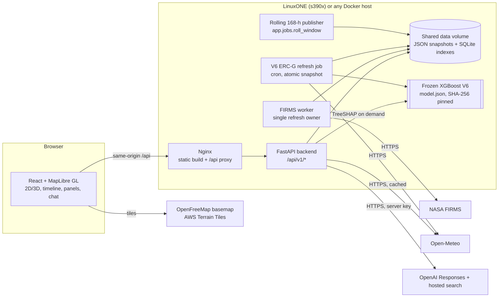

# FireWatch — California wildfire intelligence on IBM LinuxONE

FireWatch is a map-first web application for California that puts three kinds of wildfire
information side by side, each clearly labelled for what it is:

1. **Observed** — near-real-time NASA FIRMS satellite thermal-anomaly detections (hotspots).
2. **Modelled** — an experimental, explainable XGBoost estimate of fire-weather energy
   (ERC-G) for the next seven days, with per-prediction SHAP explanations.
3. **Context** — hourly weather and wind forecasts, California place/ZIP search with official
   Census boundaries, and a grounded AI assistant that only answers from that data or cited
   official sources.

It was built for the **IBM Z Datathon** with IBM LinuxONE (s390x) as the target runtime.

- **Hosted deployment:** <https://firewatch-zos.whooshzos.workers.dev/>
- **Static demo (sample data only):** <https://arsalan5shaik.github.io/IBM-Z-Datathon-FireWatch/>

> **Safety notice.** FireWatch is a research prototype. It is **not** for evacuation, dispatch
> or any emergency decision. Satellite hotspots are not confirmed fires or perimeters, and the
> model output is not a wildfire probability. Follow CAL FIRE, Cal OES, the National Weather
> Service and your county OES for official information.

---

## Contents

- [Business overview](#business-overview)
  - [The problem](#the-problem)
  - [What FireWatch offers](#what-firewatch-offers)
  - [Who it is for](#who-it-is-for)
  - [Why IBM LinuxONE](#why-ibm-linuxone)
  - [Design principles: honesty over polish](#design-principles-honesty-over-polish)
  - [Current status and limitations](#current-status-and-limitations)
  - [Roadmap](#roadmap)
- [Technical overview](#technical-overview)
  - [System architecture](#system-architecture)
  - [Repository layout](#repository-layout)
  - [Machine-learning pipeline (V6 ERC-G model)](#machine-learning-pipeline-v6-erc-g-model)
  - [Backend (FastAPI)](#backend-fastapi)
  - [Frontend (React + MapLibre)](#frontend-react--maplibre)
  - [AI assistant](#ai-assistant)
  - [Data sources](#data-sources)
  - [Shared contracts](#shared-contracts)
  - [Deployment: Docker and LinuxONE](#deployment-docker-and-linuxone)
  - [Testing and CI](#testing-and-ci)
- [Quick start](#quick-start)
- [Configuration reference](#configuration-reference)
- [Further documentation](#further-documentation)
- [Team](#team)

---

# Business overview

## The problem

California's wildfire information is spread across many places: satellite detection maps,
weather forecasts, fire-danger indices, county alert systems and news. Each uses its own
vocabulary, time zone and update cadence, and it is easy to misread one for another — a
satellite hotspot is not a confirmed fire, a fire-danger index is not a probability of
ignition, and an illustrative buffer around a detection is not a burned area.

FireWatch's goal is to bring these signals into **one map, on one timeline**, while keeping
each one honest about what it measures, when it was observed, and how reliable it is.

## What FireWatch offers

| Capability | What the user sees | Underlying data |
|---|---|---|
| **Live satellite hotspots** | Flame markers / clusters across California, sized by fire radiative power and coloured by age, with acquisition time, satellite and confidence | NASA FIRMS VIIRS NOAA-20 and NOAA-21 near-real-time products |
| **Seven-day fire-weather outlook** | Daily ERC-G estimates for the next seven days with a SHAP "Why this value?" breakdown | Frozen XGBoost V6 model + live weather forecast + 30 days of history |
| **Hourly timeline** | A "Live" slot plus 168 forecast hours, with play/pause, day jumps and valid-time vs model-run vs data-update times | Backend rolling 168-hour forecast window |
| **Weather and wind** | Temperature, humidity, precipitation and wind arrows for the selected place and hour | Open-Meteo forecast API |
| **Place search** | City, town, census-designated place, county and ZIP (ZCTA) search with typo tolerance and boundary outlines | Bundled US Census geography (3,478 validated boundaries) |
| **FireWatch AI** | A chat drawer that answers questions about the selected place and hour, cites its sources and refuses to invent scores or evacuation orders | OpenAI Responses API (`gpt-5-mini` by default) with server-side tools |
| **2D / 3D map** | One MapLibre map with a 2D view and a subtle 3D terrain view, Default/Terrain styles, shareable URLs and keyboard shortcuts | OpenFreeMap basemap, AWS Terrain Tiles DEM |

## Who it is for

- **Residents and community groups** who want one place to see what satellites currently
  detect and how fire-weather conditions are trending near them — paired with links to
  official sources rather than advice.
- **Analysts, researchers and students** who want a transparent, reproducible example of an
  explainable fire-weather model, including its validation numbers and failure modes.
- **Datathon judges and IBM Z / LinuxONE practitioners** looking for an end-to-end
  geospatial and ML workload — ingestion, inference, explanation and serving — that builds and
  runs on s390x.

FireWatch is **not** positioned as a replacement for agency products such as CAL FIRE incident
pages, NWS Red Flag Warnings or the NWCG National Fire Danger Rating System.

## Why IBM LinuxONE

The architecture was designed LinuxONE-first: one small Linux VM hosting ingestion, model
inference, explanation and the web API, with minimal operational complexity.

What the repository shows today:

- The frozen V6 model was trained, frozen and SHA-256 verified on the team's LinuxONE
  server, and the experimental V6 refresh job (`backend/scripts/run_erc_v6_hourly.sh`) is
  written to run there.
- Backend and frontend Docker images build for both `linux/amd64` and `linux/s390x` from
  locked, hash-pinned dependencies, with no source compilation. Every Python wheel used at
  runtime (Pydantic core, jiter, the OpenAI SDK, …) was verified to have an s390x build.
- Under QEMU s390x emulation the full Compose stack passes its smoke tests, reports
  `runtime_arch=s390x`, and a headless Chrome loads the UI against it. The full backend test
  suite (354 tests at the time) passed inside the s390x image.

The team deliberately makes **no unverified claims** about speed, security or uptime advantages.
Native production deployment of the Docker stack on LinuxONE hardware is still listed as
unverified in [`docs/DOCKER_LINUXONE_VERIFICATION.md`](docs/DOCKER_LINUXONE_VERIFICATION.md).

## Design principles: honesty over polish

These rules are enforced in code, tests and UI copy, not only in documentation:

- **Observed ≠ forecast.** Satellite detections and model output are separate layers with
  separate colours, legends and timestamps.
- **Hotspots ≠ fires.** A VIIRS detection is a ~375 m pixel with a thermal anomaly. It may be
  an industrial heat source; absence of detections is not proof of no fire.
- **FRP ≠ size or risk.** Fire radiative power is a proxy for intensity, never acreage.
- **Illustrative ≠ measured.** Hotspot-influence shapes are visual aids, never burned area or a
  safety radius.
- **ERC-G ≠ probability.** The model estimates a fire-weather energy index. It is never shown
  as a percentage chance of fire, and five-level categories stay hidden until calibrated.
- **Missing ≠ zero.** Missing features, hours or cells are reported as *unavailable*, never as
  low risk.
- **Sample data is always labelled.** The default static build shows a **SAMPLE DATA**
  badge; an unavailable backend shows an explicit unavailable state instead of falling back
  to synthetic data.
- **No evacuation advice.** The assistant refuses to state or invent evacuation orders and
  points to official county and state sources.
- **Secrets stay server-side.** NASA and OpenAI keys are only read by the backend; the
  Docker images are scanned layer-by-layer for leaked credentials.

## Current status and limitations

| Area | Status |
|---|---|
| NASA FIRMS ingestion and `/fires/live` | Implemented and verified against the real NASA API (e.g. 292 NOAA-20 / 347 NOAA-21 California detections retained in one refresh) |
| Open-Meteo weather and wind | Implemented with bounded batching, caching, stale fallback and verified live calls |
| Location search and boundaries | Implemented, offline and indexed; 3,478 Census boundaries |
| AI assistant | Implemented; live acceptance run with real OpenAI and hosted search passed (see [`docs/LIVE_API_VERIFICATION.md`](docs/LIVE_API_VERIFICATION.md)) |
| V6 ERC-G model | Frozen and validated on **historical observed** weather. Seven-day output currently runs as an **experimental single-cell probe for Stockton** (`CA3K_X-0038_Y-0002`), refreshed atomically on LinuxONE |
| Statewide 168-hour risk grid | Publisher, storage, API and UI are in place; a validated statewide forecast generator is **not** yet connected, so the API reports `forecast_not_ready` rather than fabricating scores |
| Risk categories (Low → Extreme) | **Not calibrated.** Scaffolding exists but categories are not emitted |
| Forecast skill | **Not yet validated** against archived forecasts; the published R² figures use observed weather |
| Docker images | Built and smoke-tested for amd64 and s390x (emulated) |

Known modelling limitations, taken from the release manifest:

- The model reconstructs **ERC-G**, not ignition probability, spread or acres burned.
- Association between predicted ERC-G and VIIRS detections was weak in the sample
  (AUROC ≈ 0.556), so the model is not an ignition predictor.
- Training used 600 selected cells, not the full statewide grid; spatial-holdout neighbours may
  share gridMET pixels; the 2025 H2 test period was examined during model selection.
- High-ERC conditions are underestimated in some months (e.g. −7.2 ERC units for the 60–89 bin
  on the October audit date).
- Wind features are present but receive zero SHAP attribution in sampled explanations, which
  is plausible for ERC-G (wind drives spread more than fuel dryness).

## Roadmap

1. Connect a statewide daily weather-forecast ETL to `forecast_daily_features.py` →
   `predict_feature_rows.py`, publishing through the existing rolling-window publisher.
2. Backtest against **archived issued forecasts** (Open-Meteo Previous Runs / Single Runs)
   with `backtest_forecasts.py`, per lead day 1–7.
3. Calibrate region-and-month relative ERC classes with `calibrate_categories.py` on held-out
   years before showing any category labels.
4. Deploy the Docker stack natively on LinuxONE behind an authenticated HTTPS gateway (needed
   before enabling paid chat publicly).
5. Replace the provisional California boundary and verify the 3 km grid against the
   authoritative geometry.

---

# Technical overview

## System architecture



Key architectural decisions:

- **Reads never compute.** API GET requests only read validated snapshots. Ingestion and
  inference run as separate, single-owner jobs guarded by process locks.
- **Atomic publication.** Every writer stages to a temporary file, validates, `fsync`s and
  `os.replace`s the pointer last. The previous good snapshot is kept for recovery
  (`manifest.previous.json`) and surfaced as *stale*, never silently.
- **JSON is authoritative; SQLite is an index.** Per-artifact SQLite indexes accelerate bbox
  and per-cell queries and are rebuilt if the source JSON fingerprint changes.
- **One map instance.** 2D/3D and Default/Terrain switches change camera pitch and terrain on
  the same MapLibre map, so layers and selection persist.
- **No heavy native dependencies in the API path.** Geometry is computed without GEOS/Shapely;
  the backend's runtime dependencies are FastAPI, Pydantic, httpx, Uvicorn, tzdata and the
  OpenAI SDK. XGBoost and NumPy are only needed for the V6 explain endpoint and ML jobs.

## Repository layout

```
.
├── backend/                 FastAPI service, jobs, tests (Python 3.11+)
│   ├── app/
│   │   ├── api/v1/          routes: status, forecasts, erc, fires, weather, locations, chat
│   │   ├── services/        FIRMS, Open-Meteo, grid, forecast store, locations, chat, OpenAI client
│   │   ├── jobs/            refresh_fires, refresh_weather, roll_window (rolling 168-h publisher)
│   │   ├── persistence/     atomic file writes, SQLite indexes
│   │   ├── schemas/         Pydantic response models
│   │   └── prompts/         version-controlled assistant system prompt
│   ├── scripts/             smoke tests, benchmarks, V6 refresh, live verification helpers
│   └── tests/               unit, integration and contract tests (mock HTTP only)
├── frontend/                Vite + React 19 + TypeScript + MapLibre GL + Zustand
│   ├── src/                 api/, state/, map/, components/, lib/, mock/
│   ├── public/data/         Census boundaries, search index, sample grid
│   ├── mock-api/            dev-only Vite middleware implementing the API contract
│   └── scripts/             geodata/grid builders and live verification scripts
├── ml-prep/                 ML research, training, evaluation and the frozen V6 release
│   ├── scripts/             data extraction, training (v1→v6), tuning, SHAP, audits, release gate
│   ├── integration/         backend handoff: predictors, explainers, forecast scaffolding, charts
│   ├── models/              model iterations, metrics, SHAP outputs, releases/
│   ├── data/                gridMET ERC/weather NetCDF, FIRMS CSVs, processed features, 3 km maps
│   └── notebooks/           ERC compatibility gate and training notebooks
├── ml/weather_elevation/    3 km grid geometry and elevation statistics
├── shared/                  JSON Schemas and examples shared between backend, ML and frontend
├── deploy/                  Nginx config, FIRMS worker, healthcheck, smoke and image-audit scripts
├── docs/                    Docker/LinuxONE guide and verification, live API verification
├── compose.yaml             three-service Docker Compose stack
├── 01_ARCHITECTURE.md …     original hackathon architecture, API, UI and prompt specs
└── FireWatch_*.csv          historical NASA FIRMS extracts for California (2024, 2025–2026)
```

## Machine-learning pipeline (V6 ERC-G model)

### Target and rationale

The model reconstructs the **gridMET Energy Release Component, Fuel Model G (ERC-G)** — a
standard fire-danger index that reflects how much energy fuels could release, driven mainly by
dryness. The original plan was a seven-day hotspot-occurrence model (preliminary label
scaffolding remains in `ml-prep/scripts/build_preliminary_7d_labels.py`). The released model
instead targets ERC-G: a well-defined, continuous index that can be estimated from forecastable
weather, checked against observed gridMET values and explained feature-by-feature.

### Data

| Source | Use |
|---|---|
| gridMET ERC-G NetCDF (2023–2025) | Training target |
| gridMET daily weather NetCDF: `tmmx` (max temp), `rmin` (min RH), `vs` (wind), `pr` (precip) | Weather features and lag history |
| 3 km California grid lookup (46,244 cells) and filled mean elevation | Spatial features and map output |
| NASA FIRMS VIIRS CSVs (2024, 2025) | Retrospective association check, not a training label |

### Features (15, fixed order)

| Group | Features |
|---|---|
| Same-day weather | `temp_max_c`, `rh_min_pct`, `wind_mean_ms`, `precip_mm` |
| Lagged history (prior days only) | `precip_7d_mm`, `precip_30d_mm`, `temp_mean_7d_c`, `rh_mean_7d_pct`, `dry_days_14d`, `wind_mean_7d_ms` |
| Static / location | `elevation_mean_m`, `lat`, `lon` |
| Seasonality | `day_sin`, `day_cos` |

No encoders or scalers are used, so inference only needs the same feature computation.

### Model iterations

`ml-prep/scripts` and `ml-prep/models` record the progression: a 2024 development model,
simple and conservative variants, regularization and tuning sweeps, v3 with lag features,
multi-year models (2023–2025), v5 and finally **V6**. V6 deliberately uses very shallow,
heavily regularized trees (max depth 2, η = 0.03, L1/L2 penalties, 299 trees) with explicit
temporal and spatial holdouts. It gives up a little test R² compared with deeper variants in
exchange for smaller generalization gaps and simpler, more stable explanations.

| Split (V6) | n | R² | MAE | RMSE | Bias |
|---|---:|---:|---:|---:|---:|
| Train (2023–2024) | 278,297 | 0.955 | 4.79 | 6.18 | 0.00 |
| Validation (2025 H1) | 71,857 | 0.936 | 5.35 | 6.78 | −2.11 |
| Test (2025 H2) | 110,400 | 0.937 | 5.68 | 7.07 | −0.09 |
| Spatial holdout (15 % of cells) | 36,743 | 0.942 | 5.24 | 6.61 | −2.13 |

**Statewide release gate.** The frozen model scored the full 3 km grid on four historical
dates (2025-04-15, 07-09, 10-15, 12-15): 46,092 of 46,244 cells per date (99.67 %; 152 cells
have missing inputs and are reported as unavailable), with R² between 0.874 and 0.943 against
observed ERC-G. This gate checks historical engineering integration, not forecast skill.

### Explainability

The most influential features, by mean |SHAP| in ERC units: 7-day mean minimum humidity
(9.3), same-day minimum humidity (7.6), 30-day precipitation (4.8), longitude (3.0), same-day
precipitation (2.8), seasonality (~1.8 each), elevation (1.5) and 7-day mean high temperature
(1.1). Explanations use XGBoost's native TreeSHAP (`pred_contribs=True`), so the separate
`shap` package is not required on s390x. The backend re-computes each explanation from the
stored feature vector and rejects it if the prediction or additivity check differs by more than
1e-3. User-friendly and technical SHAP charts are in `ml-prep/integration/charts/`.

### Release and integrity

The release lives in `ml-prep/models/releases/firewatch_erc_v6_2023_2025/` (model, features,
metrics, manifest, smoke predictions, VIIRS validation report). Its SHA-256
`cb124badd47c898448c30500fe13f4827481e1986bd2a776605a0b99308b2e33` is checked by the refresh
job, the API and the handoff bundler before any use.

### From daily model to seven-day outlook

V6 is a **daily** model. The seven-day outlook takes 30 days of observed weather plus seven
days of forecast weather, rebuilds the 15 features using prior days only (no look-ahead), and
produces **seven daily** predictions per cell. The hourly UI timeline shows each day's value
across its 24 hours; it does not claim hourly variation. See
[`ml-prep/integration/docs/168_HOUR_FORECAST_AND_CATEGORIES.md`](ml-prep/integration/docs/168_HOUR_FORECAST_AND_CATEGORIES.md).

## Backend (FastAPI)

Python 3.11/3.12, dependencies locked with `uv` (`backend/uv.lock`). The app is created with
`app.main:create_app` (factory). Startup never calls a provider, model or scheduler.

### Endpoints

| Endpoint | Purpose |
|---|---|
| `GET /health/live`, `GET /health/ready` | Liveness and API readiness (not data availability) |
| `GET /api/v1/status` | Forecast completeness, revisions, scheduler state, FIRMS/weather provider health |
| `GET /api/v1/fires/live?bbox=&hours=&limit=` | Cached VIIRS NOAA-20/21 detections with freshness metadata |
| `GET /api/v1/forecasts/risk?hour=&bbox=` | Risk grid GeoJSON for one UTC hour or California date (max/mean aggregation) |
| `GET /api/v1/forecasts/cell/{cell_id}?start=&end=` | Up to 168 hourly values with explicit missing slots |
| `GET /api/v1/erc/metadata` | Current V6 snapshot provenance and caveats |
| `GET /api/v1/erc/cells/{cell_id}` | Seven daily ERC-G predictions for a cell (categories `not_calibrated`) |
| `GET /api/v1/erc/cells/{cell_id}/explain?date=&snapshot_id=` | Verified TreeSHAP breakdown for one cell/day |
| `GET /api/v1/weather?latitude=&longitude=&hour=` | Hourly forecast at the nearest display anchor |
| `GET /api/v1/wind?bbox=&hour=&density=` | Wind sample GeoJSON |
| `GET /api/v1/locations/search?q=` | California place/county/ZIP search |
| `GET /api/v1/locations/{id}/boundary` | Census boundary GeoJSON |
| `POST /api/v1/chat` | Grounded assistant |
| `GET /docs`, `GET /openapi.json` | Interactive OpenAPI documentation |

Every response carries `X-Request-ID` and `Cache-Control: no-store`. Errors use one envelope:
`{"error": {"code": "...", "message": "...", "details": {}}}`.

### Background jobs

| Job | Command | Notes |
|---|---|---|
| FIRMS refresh | `python -m app.jobs.refresh_fires` (or `deploy/worker.py` loop) | One owner only; atomic cache in `shared/data/provider-cache/firms.json` |
| Rolling forecast window | `python -m app.jobs.roll_window --revision revision.json` | Hourly; targets the next UTC hour + 167; reuses unchanged hours; content-addressed grids; manifest replaced last |
| Weather inputs export | `python -m app.jobs.refresh_weather --mapping mapping.json` | Proposed ML input contract; refuses stale or mismatched grids |
| V6 ERC-G refresh | `backend/scripts/run_erc_v6_hourly.sh` → `refresh_erc_v6.py` | LinuxONE cron; verifies model hash, validates 7 predictions, versioned + atomic `current.json` |

Run exactly one scheduler owner per data store (`JOB_ENABLED=true` requires
`SCHEDULER_OWNER=backend`). Details are in [`backend/README.md`](backend/README.md).

## Frontend (React + MapLibre)

- **Stack:** Vite 8, React 19, TypeScript, MapLibre GL 6, Zustand, d3-contour, lucide icons.
  No API keys required for the basemap (OpenFreeMap), terrain (AWS Terrain Tiles) or bundled
  Census boundaries.
- **Data modes:** *Sample* (default; generated in-browser, labelled SAMPLE DATA), *Backend*
  (`VITE_API_BASE_URL=/api/v1` at build time or `?api=https://host/api/v1` at run time), and an
  explicit *Unavailable* state when the backend fails.
- **UI:** top bar with search and data-status pill; layer controls (live fires, risk, perimeters,
  wind, weather, vegetation, opacity, units); hourly timeline with sparkline and calendar jump;
  details panel/bottom sheet with hourly chart, conditions and SHAP bars; the V6 ERC-G panel;
  chat drawer with an offline fallback assistant; shareable URL state; keyboard shortcuts;
  reduced-motion support.
- **Code organization:** `api/` (provider interface and backend client), `state/` (store,
  polling, URL state, chat), `map/` (style, layers, sync, interactions), `components/`,
  `lib/` (California time, geo, search ranking, risk scale, offline assistant), `mock/`
  (sample generator).

See [`frontend/README.md`](frontend/README.md) and
[`frontend/API_INTEGRATION.md`](frontend/API_INTEGRATION.md).

## AI assistant

`POST /api/v1/chat` uses the official OpenAI Python SDK and the Responses API (default model
`gpt-5-mini`, configurable). The key is read only by the backend.

- **Server-side tools** reuse the same location, weather, wind, FIRMS and forecast services the
  map uses, so answers are grounded in the exact data on screen.
- **Hosted web research** is domain-filtered and capped; citations are validated against the
  pages actually retrieved, and unverifiable answers are rejected.
- **Reference mode** answers standard definitions (FRP, VIIRS confidence, hotspot vs fire) from
  version-controlled NASA text with no model call.
- **Guards** reject invented scores, SHAP values or detections, unsupported capabilities and
  any current evacuation-order claims; Pacific-time and unit conversions are checked against
  cited timestamps.
- **Cost and abuse controls:** per-client and daily request limits, concurrency limits, bounded
  retries, request deadlines and a `trusted_proxy` access mode. The Docker stack blocks
  `/api/v1/chat` at Nginx by default until an authenticated gateway exists.

Details: [`backend/CHATBOT.md`](backend/CHATBOT.md).

## Data sources

| Source | Purpose | Access |
|---|---|---|
| [NASA FIRMS](https://firms.modaps.eosdis.nasa.gov/api/area/) VIIRS NOAA-20 / NOAA-21 NRT | Live hotspots | Free MAP_KEY (`NASA_FIRMS_MAP_KEY`) |
| [Open-Meteo](https://open-meteo.com/en/docs) forecast API | Weather, wind, V6 forecast inputs | Keyless |
| [gridMET](https://www.climatologylab.org/gridmet.html) | ERC-G target and historical weather for training | Public NetCDF |
| US Census TIGER/Line, ZCTA | Place, county and ZIP boundaries | Bundled |
| OpenFreeMap, AWS Terrain Tiles | Basemap and DEM | Keyless, public |
| OpenAI Responses API | Assistant | `OPENAI_API_KEY` (backend only) |

## Shared contracts

`shared/schemas/` holds JSON Schemas for the forecast manifest, per-hour forecast files and
proposed weather sampling/input contracts; `shared/examples/` holds matching fixtures. Backend
contract tests validate against them, and the frontend mock API speaks the same contract.

## Deployment: Docker and LinuxONE

`compose.yaml` runs three services sharing a named `runtime-data` volume:

| Service | Role |
|---|---|
| `frontend` | Nginx (UID 101) serving the static build and proxying `/api/*`; the only published port (`127.0.0.1:8080` by default) |
| `backend` | FastAPI on port 8000 (UID 10001) |
| `firms-worker` | Single FIRMS refresh loop (UID 10001) |

Hardening: read-only root filesystems, `tmpfs` `/tmp`, all capabilities dropped,
`no-new-privileges`, rotated logs, no Docker socket or source mount, fixtures disabled,
in-API scheduler disabled. Base images are pinned by multi-platform digest (Debian Trixie
variants were chosen because the Bookworm slim manifests lack s390x). Python wheels install
with `--require-hashes --only-binary=:all:`. On s390x builders only CSS minification is
disabled, because `lightningcss` ships no s390x binary.

```sh
docker buildx build --platform linux/s390x --target runtime --load -f backend/Dockerfile  -t firewatch-backend:s390x .
docker buildx build --platform linux/s390x --target runtime --load -f frontend/Dockerfile -t firewatch-frontend:s390x .
NASA_FIRMS_MAP_KEY=... docker compose up -d --wait
```

The full guide is in [`docs/DOCKER_LINUXONE.md`](docs/DOCKER_LINUXONE.md), with evidence in
[`docs/DOCKER_LINUXONE_VERIFICATION.md`](docs/DOCKER_LINUXONE_VERIFICATION.md).

## Testing and CI

| Workflow | Runs |
|---|---|
| `backend-ci.yml` | pytest (unit, integration, contract; real HTTP blocked), Ruff lint/format, process and fixture HTTP smoke on Linux Python 3.11/3.12 and Windows 3.11 |
| `docker-linuxone.yml` | Dockerfile/Compose validation, amd64 + s390x image builds, layer secret audit, Compose lifecycle smoke, backend suite inside the target-arch image, frontend tests |
| `frontend-pages.yml` | Frontend build, tests and GitHub Pages deploy on `main` |
| `weather-frontend-ci.yml` | Frontend checks for feature branches |

The repository contains about 215 backend test functions and 60+ frontend Vitest cases.
Live-provider checks (NASA, Open-Meteo, OpenAI) are separate manual scripts so CI never spends
money or depends on external uptime.

---

# Quick start

**Frontend only (sample data, no keys):**

```sh
cd frontend
npm ci
npm run dev          # http://localhost:5173
```

**Backend:**

```sh
python -m pip install uv==0.13.1
cd backend
uv sync --locked --python 3.11
cp .env.example .env   # optionally add NASA_FIRMS_MAP_KEY / OPENAI_API_KEY
uv run --no-sync uvicorn app.main:create_app --factory --host 127.0.0.1 --port 8000 --no-access-log
# in another terminal, optionally:
uv run --no-sync python -m app.jobs.refresh_fires
```

Then open `http://localhost:5173/?api=http://127.0.0.1:8000/api/v1` (with the Vite origin
in `CORS_ORIGINS`), or use the frontend dev proxy:
`FIREWATCH_API_PROXY=http://localhost:8000 npm run dev` and open `?api=/api/v1`.

**Tests:**

```sh
cd backend && uv run --no-sync python -m pytest && uv run --no-sync python -m ruff check .
cd frontend && npm test && npm run build
```

**Full stack in Docker:** see [Deployment](#deployment-docker-and-linuxone).

# Configuration reference

| Variable | Where | Default | Purpose |
|---|---|---|---|
| `NASA_FIRMS_MAP_KEY` | backend / worker | unset | NASA FIRMS key |
| `FIRMS_SOURCES` | backend | NOAA-20 + NOAA-21 NRT | FIRMS products to ingest |
| `FIRMS_REFRESH_MINUTES` | worker | 15 | Refresh throttle |
| `OPENAI_API_KEY` | backend | unset | Enables chat; missing ⇒ explicit 503 |
| `OPENAI_MODEL` | backend | `gpt-5-mini` | Assistant model |
| `CHAT_ACCESS_MODE` / `CHAT_PROXY_TOKEN` | backend | `local` | `trusted_proxy` requires a 32+ char token |
| `SHARED_DATA_DIR`, `SQLITE_PATH`, `REPO_ROOT` | backend | repo-relative | Data store locations |
| `JOB_ENABLED`, `SCHEDULER_OWNER` | backend | `false`, `unassigned` | Single-publisher control |
| `ALLOW_FIXTURE_DATA` | backend | `false` | Permit labelled fixture forecasts |
| `CORS_ORIGINS` | backend | `[]` | Exact allowed browser origins |
| `VITE_API_BASE_URL` | frontend build | empty | Backend URL; empty ⇒ sample mode |

Full lists: `backend/.env.example`, `deploy/.env.example`, [`backend/CHATBOT.md`](backend/CHATBOT.md).

# Further documentation

| Document | Contents |
|---|---|
| [`backend/README.md`](backend/README.md) | API setup, rolling publisher, FIRMS and weather integration |
| [`backend/IMPLEMENTATION_STATUS.md`](backend/IMPLEMENTATION_STATUS.md) | Feature-by-feature implementation log |
| [`backend/FIRMS.md`](backend/FIRMS.md), [`backend/WEATHER_INTEGRATION.md`](backend/WEATHER_INTEGRATION.md), [`backend/LOCATIONS_INTEGRATION.md`](backend/LOCATIONS_INTEGRATION.md), [`backend/CHATBOT.md`](backend/CHATBOT.md) | Per-provider details |
| [`frontend/README.md`](frontend/README.md), [`frontend/API_INTEGRATION.md`](frontend/API_INTEGRATION.md) | UI, data modes, API client |
| [`ml-prep/integration/README_START_HERE.md`](ml-prep/integration/README_START_HERE.md) | V6 model handoff and limitations |
| [`ml-prep/integration/docs/168_HOUR_FORECAST_AND_CATEGORIES.md`](ml-prep/integration/docs/168_HOUR_FORECAST_AND_CATEGORIES.md) | Seven-day outlook and category calibration plan |
| [`docs/DOCKER_LINUXONE.md`](docs/DOCKER_LINUXONE.md), [`docs/DOCKER_LINUXONE_VERIFICATION.md`](docs/DOCKER_LINUXONE_VERIFICATION.md) | Container deployment and s390x evidence |
| [`docs/LIVE_API_VERIFICATION.md`](docs/LIVE_API_VERIFICATION.md) | Real-provider verification runs |
| [`FireWatch_Backend_Architecture.md`](FireWatch_Backend_Architecture.md), [`01_ARCHITECTURE.md`](01_ARCHITECTURE.md), [`02_API_CONTRACT.md`](02_API_CONTRACT.md), [`03_UI_DESIGN.md`](03_UI_DESIGN.md), [`FireWatch_Frontend_Spec.md`](FireWatch_Frontend_Spec.md) | Original design specifications |
| [`04_HACKATHON_PROMPTS.md`](04_HACKATHON_PROMPTS.md), [`FireWatch_UI_Concept.html`](FireWatch_UI_Concept.html) | Hackathon plan and clickable UI wireframe |

# Team

Built for the IBM Z Datathon by a six-person team: an ML workstream (Ridwan, Eshann, Serena)
covering labels and evaluation, weather/fire feature engineering, and inference/explanation;
and an application workstream covering the backend and LinuxONE setup, the MapLibre UI and
search, and ingestion, chat and 3D QA.
